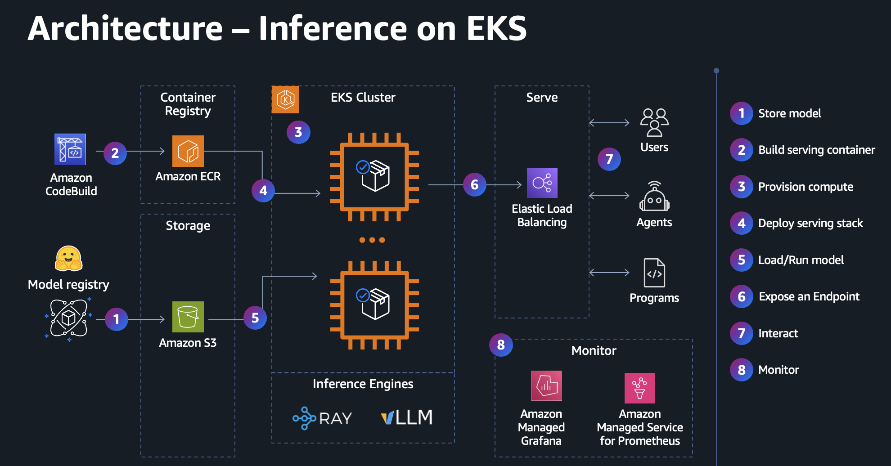

# Deploy and Benchmark GPT-OSS-20B on AWS Trainium with Amazon EKS

A blueprint for serving open-weight models on AWS Trainium2 (`trn2`) with
Amazon EKS, the AWS Neuron SDK and vLLM. It takes OpenAI's **gpt-oss-20b** from
its Hugging Face checkpoint to a measured inference endpoint, in four sections:

1. **Infrastructure:** reserve Trainium capacity and deploy the model serving platform with Terraform.
2. **Serving:** compile the model ahead of time and deploy the vLLM endpoint (and optionally Ray Serve).
3. **Observability:** review the metrics, logs and dashboards behind the endpoint.
4. **Benchmark:** measure the config's best latency, max throughput and goodput under your SLA, with one vLLM command.

Nothing is hidden or abstracted. You build the stack step by step, so you
understand every moving part.

> **Important:** the Neuron inference stack is converging on the [vLLM Neuron plugin](https://github.com/vllm-project/vllm-neuron)
> (currently **Beta**, Trn2/Trn3 only). When adopting this solution, track the
> plugin's beta status and maturity, and confirm you can secure Trn2 capacity.
> To run a previous version of this demo based on the older vLLM+NxDI Neuron plugin
> on Trn1 instances, switch to **branch vllm-nxdi-0.16**.



The platform underneath covers every area a model endpoint needs:

| Area | What this blueprint sets up |
|---|---|
| **Model storage** | Weights in S3 (downloaded once from Hugging Face), pulled to node NVMe with the CRT client; a shared EFS compile cache for Neuron graphs |
| **Serving container** | vLLM with the vLLM Neuron plugin (and Ray Serve, optional), images built into ECR by a CodeBuild pipeline, CVE-scanned on push and pre-pulled onto Trainium nodes |
| **Compute** | Amazon EKS, Karpenter node pools on demand and on EC2 Capacity Blocks for ML, Trainium devices claimed through the Neuron DRA driver |
| **Ingress Endpoint** | An internal Application Load Balancer in front of each vLLM service |
| **Observability** | Prometheus and Grafana for Neuron hardware and vLLM serving metrics (TTFT, inter-token latency, tokens/s); Fluent Bit to CloudWatch Logs |
| **Security** | Least-privilege IAM through EKS Pod Identity, private subnets, VPC endpoints for AWS traffic, encrypted storage |
| **Infrastructure as code** | One Terraform template deploys the platform infrastructure |
| **Deployment** | One Helm chart and one values file per serving config, for every step: compile, warm up, serve, benchmark |
| **Benchmarking** | vLLM's built-in sweep in the same chart: latency, max throughput and goodput against an SLA, cost per token, client- and server-side views |

## Prerequisites

- **Tools:** Terraform, `kubectl`, `helm`, AWS CLI v2, `jq`, Python 3
- **AWS credentials** for the target account

## Section 1: Infrastructure

The demo serves `openai/gpt-oss-20b` with the AWS Neuron vLLM container (vLLM
Neuron plugin 0.29, Neuron SDK 2.33) on Trainium2, on any `trn2` size: each
vLLM replica claims the Trainium2 devices it needs through the Neuron DRA
driver, so one replica (TP4 on one device) fits a `trn2.3xlarge` (1 device),
and up to 16 fit a `trn2.48xlarge` (16 devices).

The same platform also serves it on NVIDIA GPUs with the upstream vLLM
container: on the `gpu-g6e` node pool (one
L40S per node, on-demand, no reservation needed), or on a p5 (H100)
Capacity Block. Each step below notes what changes on GPU.

### 1. Reserve Trainium capacity

Use [EC2 Capacity Blocks for ML](https://aws.amazon.com/ec2/capacityblocks/) to
reserve `trn2` capacity.

Find available blocks across regions (read-only; `-h` for options such as
`--hours` and `--start`):

```bash
scripts/list-capacity-block-offerings.py --instance-types trn2.3xlarge trn2.48xlarge --hours 24
```

Buy the block with the offering ID and region from the table. This purchase is
charged: the script checks your permissions, lists the offering and asks you to
type `yes` first.

```bash
scripts/purchase-capacity-block.py <offering-id>,<region>
```

Once your block is reserved, list it:

```bash
scripts/list-reserved-capacity-blocks.py
```

<details>
<summary><b>On GPU</b> (optional)</summary>

Reserve a p5 (H100) block the same way (`--instance-types p5.4xlarge`). The
dynamic `gpu-g6e` pool (L40S, on-demand) needs no reservation, if you'd
rather use it.

</details>

### 2. Apply Terraform

```bash
cp terraform/terraform.tfvars.example terraform/terraform.tfvars
```

Edit `terraform/terraform.tfvars`: set the block's region and add a
`capacity_blocks_nodepools` entry for it. The key names the node pool
Terraform creates for the block (one static node pool per Capacity Block):

```hcl
region = "us-east-2"

capacity_blocks_nodepools = {
  "neuron-trn2" = {
    reservation_id = "cr-..."
    instance_type  = "trn2.3xlarge"
    az             = "us-east-2b"
    node_count     = 1
    hardware       = "neuron"
  }
}
```

<details>
<summary><b>On GPU</b> (optional)</summary>

Add an entry for the p5 block. Its key is the node pool that
[`values-gpt-oss-p5-tp1.yaml`](vllm-serving/values-gpt-oss-p5-tp1.yaml) pins to (`nodepool: gpu-p5-4xl`):

```hcl
  "gpu-p5-4xl" = {
    reservation_id = "cr-..."
    instance_type  = "p5.4xlarge"
    az             = "us-east-2a"
    node_count     = 1
    hardware       = "gpu"
  }
```

No entry needed for g6e capacity, just ensure that capacity is available in the region.

</details>

The other inputs have defaults. Override them in `terraform.tfvars` if needed
(see [`variables.tf`](terraform/variables.tf)). The serving images are not
inputs: each is a folder in [`terraform/container-images/`](terraform/container-images/):

```bash
terraform -chdir=terraform init
terraform -chdir=terraform apply
```

<details>
<summary><b>What Terraform deploys</b> (click to expand)</summary>

**VPC Networking** ([`vpc.tf`](terraform/vpc.tf))

- A VPC with public and private subnets across the region's AZs, and a NAT
  gateway. Nodes run in the private subnets.
- **VPC endpoints:** nodes reach ECR (image pulls), CloudWatch Logs, STS and EKS
  Auth (Pod Identity) through interface endpoints, and S3 through a gateway
  endpoint, over private IPs instead of the NAT gateway. The NAT gateway stays for HuggingFace, public
  registries and GitHub.

**Compute**

- **EKS cluster and add-ons** ([`eks.tf`](terraform/eks.tf), [`addons.tf`](terraform/addons.tf)):
  a managed node group runs every controller (Karpenter, CoreDNS, AWS Load
  Balancer Controller, KubeRay operator, EFS CSI controller,
  Prometheus/Grafana), pinned with `nodeSelector: karpenter.sh/controller=true`.
  Node agents run as DaemonSets that tolerate every taint, so they also run on
  the Trainium nodes: the Neuron DRA driver, neuron-monitor, the EFS CSI node
  driver, Fluent Bit and node-exporter.
- **Accelerators through DRA** ([Dynamic Resource Allocation](https://kubernetes.io/docs/concepts/scheduling-eviction/dynamic-resource-allocation/)):
  the Neuron DRA driver (DeviceClass `neuron.aws.com`) publishes every Trainium
  device with its attributes, and pods claim them with ResourceClaims instead of
  device-plugin counts. A claim for N devices takes N *connected* devices, so
  tensor parallelism stays on neighbouring devices (on `trn2.48xlarge`'s 16).
- **Karpenter node pools** ([`karpenter.tf`](terraform/karpenter.tf), [`karpenter/`](terraform/karpenter/)):
  - **Default Nodepool:** `x86-cpu-karpenter`, On-Demand c/m/r instances with
    local NVMe (c5d/m5d/r5d, c6id/m6id/r6id where offered), 4xlarge to 32xlarge,
    for CPU work (the model weights Job, Neuron CPU compile Jobs, the Ray head).
    The NVMe holds the pods' ephemeral storage and the container images, so
    weights, compile caches and image pulls run at local-disk speed. A node
    launches when a pod needs one, sized to its requests, and is removed when
    empty.
  - **Generated from `capacity_blocks_nodepools`:** one static pool per entry
    ([template](terraform/karpenter/capacity-block-nodepool.yaml.tftpl)), pinned
    to the block's instance type and AZ on reserved capacity. It keeps the
    block's instances running until the block ends.
  - The Trainium pool is tainted, so only pods that tolerate the taint land
    there. Its NVMe instance store is mounted at `/mnt/k8s-disks/0`.
- **AMIs:** an EC2NodeClass per AMI input: `x86-cpu-karpenter` (EKS-optimized
  standard) and `neuron` (EKS-optimized Neuron: drivers and runtime). The
  Capacity Block's reservation is attached to the `neuron` NodeClass.
- **NVIDIA GPUs:** the NVIDIA GPU Operator (DCGM exporter, node labels), the
  NVIDIA DRA driver (GPUs claimed like Trainium devices), a `gpu` NodeClass
  (EKS-optimized NVIDIA AMI) and a dynamic `gpu-g6e` pool: the g6e family
  (NVIDIA L40S), on-demand, tainted like the Trainium pool.

**Model storage** ([`s3.tf`](terraform/s3.tf), [`efs.tf`](terraform/efs.tf))

- **S3 bucket** for the model weights and benchmark results, so nodes download
  the weights faster and privately instead of from HuggingFace (through the S3
  gateway endpoint). Encrypted, versioned, public access blocked.

  | S3 | Node | Holds |
  |---|---|---|
  | `s3://<bucket>/<model>/` | `/tmp/models/<model>/` (NVMe) | weights |
  | `s3://<bucket>/benchmarks/` | - | benchmark results |

  Set `existing_cache_bucket` to reuse a bucket from an earlier cluster (same
  region and account) instead of creating one. Terraform only reads it, so the
  weights and results survive `terraform destroy`.

- **Permissions** (EKS Pod Identity): two service accounts, `s3-writer`
  (S3 read/write: the Jobs) and `s3-reader` (S3 read-only: serving pods).
- **Weights Job:** one `model-weights-<model>` Job per `models` entry. It
  downloads the checkpoint from HuggingFace once and uploads it to S3.
- **Shared Neuron compile cache (EFS):** an encrypted EFS file system (elastic
  throughput, a mount target per AZ) behind the `neuron-cache` PVC, mounted by
  every Neuron compile and serving pod as the vLLM Neuron plugin's remote cache
  (`TORCH_NEURONX_NEFF_CACHE_DIR`, `NEURON_LIBTORCH_REMOTE_CACHE`). Compile
  Jobs write each compiled graph (NEFF) into it; serving pods on any node read
  it. It has the cluster's
  lifecycle: `terraform destroy` deletes it.

**Serving containers** ([`codebuild-ecr-serving-containers.tf`](terraform/codebuild-ecr-serving-containers.tf))

- **ECR** hosts the serving container images, for faster, private pulls from
  inside the VPC (through the ECR endpoints). Every pushed image is scanned for
  CVEs (scan on push; findings in the ECR console or
  `aws ecr describe-image-scan-findings`).
- **CodeBuild** builds one image per folder of
  [`terraform/container-images/`](terraform/container-images/), each into its own ECR repository.
  The folder is the build context: its `Dockerfile` names the base image and
  any commands on top, plus `LABEL hardware=neuron|gpu`. Add a folder to build
  another image. The defaults:
  - `vllm-neuron`: the vLLM-Neuron DLC
  - `ray-neuron`: Ray Serve on the same DLC as `vllm-neuron`
  - `vllm-neuron-perf`: `vllm-neuron` with a patched vLLM Neuron plugin and NKI
    library (faster MoE kernels), to compare against the stock one
  - `vllm-gpu`, `ray-gpu`: the GPU equivalents, on the upstream vLLM image

  Tags are a hash of the folder, so any change is a new tag. `terraform apply`
  waits for the builds (a few minutes each).
- **Image warmer:** a DaemonSet per hardware, `image-warmer-neuron` and
  `image-warmer-gpu`, pre-pulls every image of that hardware onto each of its
  nodes as soon as the node joins the cluster.

**Endpoint exposure** ([`addons.tf`](terraform/addons.tf))

- **AWS Load Balancer Controller** (EKS Pod Identity): turns Ingresses into
  Application Load Balancers. The serving chart's Ingress and Grafana's each get
  an **internal** ALB in the private subnets, reachable only from the VPC.

**Observability** ([`observability.tf`](terraform/observability.tf), [`addons.tf`](terraform/addons.tf))

- **neuron-monitor** DaemonSet on every Trainium node: NeuronCore utilization,
  device memory, execution latency and errors, at 1 s.
- **NVIDIA DCGM exporter** (NVIDIA GPU Operator) on every GPU node: GPU
  utilization, memory, power and temperature, at 1 s, per GPU and node
  (`hostname`). The operator also creates its ServiceMonitor.
- **kube-prometheus-stack:** Prometheus (1 s scrapes of vLLM, neuron-monitor,
  DCGM and Ray, through the ServiceMonitors and PodMonitors in
  [`scrape-configs/`](terraform/scrape-configs/)) and Grafana with the
  dashboards in [`grafana-dashboards/`](terraform/grafana-dashboards/) (vLLM,
  Neuron, GPU, Ray, Benchmark), on an internal ALB, admin password generated into a
  Secret.

**Logging** ([`logging.tf`](terraform/logging.tf))

- **Fluent Bit** (`aws-for-fluent-bit`) on every node ships container logs to
  CloudWatch Logs, log group `/aws/eks/<name>/containers`, one stream per
  container (`<namespace>.<pod>.<container>`), kept 14 days. Logs outlive their pods and nodes.

</details>

### 3. Export the outputs

Export the Terraform outputs the next steps use:

```bash
export AWS_REGION="$(terraform -chdir=terraform output -raw region)"
export S3_BUCKET_NAME="$(terraform -chdir=terraform output -raw model_storage_bucket)"
export VLLM_NEURON_IMAGE="$(terraform -chdir=terraform output -json serving_images | jq -r '."vllm-neuron"')"
export VLLM_NEURON_IMAGE_PERF="$(terraform -chdir=terraform output -json serving_images | jq -r '."vllm-neuron-perf"')"
export VLLM_GPU_IMAGE="$(terraform -chdir=terraform output -json serving_images | jq -r '."vllm-gpu"')"
```

`serving_images` lists every image built from `terraform/container-images/`; to serve
another one, export its entry instead.

### 4. Check the infrastructure

```bash
$(terraform -chdir=terraform output -raw configure_kubectl)

kubectl get nodepools
kubectl get nodes -L karpenter.sh/nodepool,node.kubernetes.io/instance-type
kubectl wait --for=condition=complete job -l app=model-weights --timeout=60m
kubectl get resourceslices
kubectl get pvc neuron-cache
```

Expect the Trainium node `Ready`, the weights Job complete, one
ResourceSlice listing the trn2 node's Trainium devices (Neuron DRA driver), and the
`neuron-cache` PVC `Bound` (the shared compile cache).

## Section 2: Serving inference

One Helm chart, [`vllm-serving`](vllm-serving/), drives every serving step
from the same values file per serving config. Each field
is documented in the chart's [`values.yaml`](vllm-serving/values.yaml). The
`mode` value picks the step, and every mode builds the vLLM engine from the same values file, to ensure that cached Neuron compilation artifacts are reused.

| `mode` | Runs | Where |
|---|---|---|
| `compile` | Builds the engine, compiling every graph into the shared cache, then exits | x86 CPU |
| `warmup` | Builds, compiles, and starts vLLM engine, runs a smoke test, then exits | Trainium |
| `serve` (default) | Deploys the vLLM endpoint: Deployment, Service, optional ALB ingress | Trainium or GPU |
| `bench` | Benchmarks the config with `vllm bench sweep serve_workload` (Section 4) | Trainium or GPU |

Review serving parameters in the pre-set config:
```bash
export CFG=gpt-oss-trn2-tp4
cat vllm-serving/values-$CFG.yaml
```

> **Important:** to serve with different parameters, create another values
> file (`vllm-serving/values-<name>.yaml`) and set `CFG=<name>`. Every release,
> compile cache manifest and benchmark result is named after `CFG`, so a new
> config gets its own compile, endpoint and results instead of overwriting the
> existing ones.

<details>
<summary><b>On GPU</b> (optional)</summary>

Use `CFG=gpt-oss-p5-tp1` (or `gpt-oss-g6e-tp1`) and
`image=$VLLM_GPU_IMAGE` in the commands below, and skip step 1: compile and
warmup are Neuron only (vLLM builds its CUDA graphs at startup).

</details>


### 1. Compile ahead of time

Before it can serve, the vLLM Neuron plugin compiles the model's graphs into
NEFFs (Neuron executables), which takes minutes to hours.

Compile once, ahead of time, into the shared cache on EFS, and every replica on
any node reuses the compiled NEFFs. A graph's cache key covers its structure
and shapes, the target, the logical NeuronCore size and the compiler version.
The `vllm-serving` chart compiles and serves with the same parameters from the
same values file, so serving finds the cached NEFFs.

**Compile on CPU.** For this demo, compile on CPU. The plugin's CPU compile
mode (`VLLM_NEURON_CPU_COMPILE=1`) builds the engine and compiles every graph
for `trn2` without a device, so no Trainium time is spent compiling. The Job
runs on the x86 node pool, on a node sized by `compile.cpu` and
`compile.memory`:

```bash
helm upgrade --install $CFG-compile vllm-serving -f vllm-serving/values-$CFG.yaml --set mode=compile \
  --set region=$AWS_REGION --set s3Bucket=$S3_BUCKET_NAME --set image=$VLLM_NEURON_IMAGE

kubectl logs -f -l app.kubernetes.io/instance=$CFG-compile -c compile --tail=-1
kubectl wait --for=condition=complete job -l app.kubernetes.io/instance=$CFG-compile --timeout=180m
```

<details>
<summary><b>Warm up on Trainium</b> (optional)</summary>

A CPU compile proves that the graphs compile, not that they run. The warmup
mode is the gate for that: it starts `vllm serve` on Trainium, compiles any NEFF
still missing from the cache (all of them without the CPU compile), saves them
and the traced graphs to EFS, then runs a short smoke test that must finish
with no failed requests.

```bash
helm upgrade --install $CFG-warmup vllm-serving -f vllm-serving/values-$CFG.yaml --set mode=warmup \
  --set region=$AWS_REGION --set s3Bucket=$S3_BUCKET_NAME --set image=$VLLM_NEURON_IMAGE

kubectl logs -f -l app.kubernetes.io/instance=$CFG-warmup -c warmup --tail=-1
kubectl wait --for=condition=complete job -l app.kubernetes.io/instance=$CFG-warmup --timeout=120m
helm uninstall $CFG-warmup
```

</details>

Both Jobs save their results to the shared cache on the `neuron-cache` EFS
volume, in a folder per image (`<key>`, a hash of the image URI), so two images
never share compiled graphs:

- **Compile on CPU** compiles the NEFFs into the cache: the chart points the
  plugin's NEFF cache at the volume
  (`TORCH_NEURONX_NEFF_CACHE_DIR=/neuron-cache/<key>/native-neff`).
- **Warm up on Trainium** (optional) compiles any missing NEFF into the same
  cache, and also saves the traced graphs: the plugin's precompile directory
  (`<VLLM_CACHE_ROOT>/neuron/torch_compile`) is mounted from the volume's
  `<key>/torch-compile`. Without the warmup, the first serving pod traces the
  graphs and saves them there.

Each Job also writes a manifest of the graphs it built to
`/neuron-cache/<key>/manifests/<release>/`. With both in the cache, serving pods
on any node skip tracing as well as compiling.

### 2. Deploy the vLLM endpoint

The serve mode (default) creates a Deployment with the file's replicas, a
Service and, optionally (`--set ingress.enabled=true`), an internal ingress ALB
to expose it inside the VPC. Each pod claims its Trainium device through the
Neuron DRA driver (one ResourceClaim per pod) on any Trainium node with a free
device, syncs the weights from S3 to the node's NVMe (init-container), and runs
`vllm serve /tmp/models/gpt-oss-20b` with the same engine flags as the compile:

```bash
helm upgrade --install $CFG vllm-serving -f vllm-serving/values-$CFG.yaml \
  --set region=$AWS_REGION --set s3Bucket=$S3_BUCKET_NAME --set image=$VLLM_NEURON_IMAGE

kubectl rollout status deploy/$CFG --timeout=60m
kubectl get pods -l app=$CFG -o wide
kubectl get resourceclaims
```

<details>
<summary><b>On GPU</b> (optional)</summary>

The same release with the GPU config and image. The pod claims one GPU through
the NVIDIA DRA driver on the p5 block's node:

```bash
export CFG=gpt-oss-p5-tp1
helm upgrade --install $CFG vllm-serving -f vllm-serving/values-$CFG.yaml \
  --set region=$AWS_REGION --set s3Bucket=$S3_BUCKET_NAME --set image=$VLLM_GPU_IMAGE

kubectl rollout status deploy/$CFG --timeout=60m
kubectl get pods -l app=$CFG -o wide
```

</details>

> **Cache miss?** Serving pods start from the compiled graphs on EFS. A graph
> that isn't there (values that differ from what was compiled) is compiled on
> Trainium at startup, minutes to tens of minutes, and then written to EFS, so
> the next pod hits it.

#### Send requests

```bash
kubectl port-forward svc/$CFG 8080:8080 &

curl -s localhost:8080/v1/models | jq
curl -s localhost:8080/v1/chat/completions -H "Content-Type: application/json" \
  -d '{"model": "/tmp/models/gpt-oss-20b", "messages": [{"role": "user", "content": "What is AWS Trainium?"}]}' | jq
```

### 3. (Optional) Deploy Ray Serve

Deploy the model with Ray Serve: the [`rayserve-serving`](rayserve-serving/)
chart, similar to `vllm-serving` with Ray Serve as the server. It takes the same
values file and has the same compile and warmup modes; serve mode (default) creates a
RayService, with a Ray head on the x86 pool and a worker on a Trainium node
running the vLLM engine in [`vllm_ray_app.py`](rayserve-serving/files/vllm_ray_app.py).
The worker claims its device through the Neuron DRA driver.

Ray runs its own image, `ray-neuron`, so it gets its own compiled graphs: the
shared cache is keyed by image, so a different build never loads another
image's graphs. On a `trn2.3xlarge`, free the device first:

```bash
helm uninstall $CFG
export RAY_NEURON_IMAGE="$(terraform -chdir=terraform output -json serving_images | jq -r '."ray-neuron"')"
```

**Compile on CPU.** As in step 1, with the Ray image: it compiles the graphs
into the Ray image's cache.

```bash
helm upgrade --install $CFG-ray-compile rayserve-serving -f vllm-serving/values-$CFG.yaml --set mode=compile \
  --set region=$AWS_REGION --set s3Bucket=$S3_BUCKET_NAME --set image=$RAY_NEURON_IMAGE

kubectl logs -f -l app.kubernetes.io/instance=$CFG-ray-compile -c compile --tail=-1
kubectl wait --for=condition=complete job -l app.kubernetes.io/instance=$CFG-ray-compile --timeout=180m
```

<details>
<summary><b>Warm up on Trainium</b> (optional)</summary>

As in step 1, the gate that the engine runs on Trainium, with the Ray image:

```bash
helm upgrade --install $CFG-ray-warmup rayserve-serving -f vllm-serving/values-$CFG.yaml --set mode=warmup \
  --set region=$AWS_REGION --set s3Bucket=$S3_BUCKET_NAME --set image=$RAY_NEURON_IMAGE

kubectl logs -f -l app.kubernetes.io/instance=$CFG-ray-warmup -c warmup --tail=-1
kubectl wait --for=condition=complete job -l app.kubernetes.io/instance=$CFG-ray-warmup --timeout=120m
helm uninstall $CFG-ray-warmup
```

</details>

**Serve.** The RayService loads the compiled graphs from the cache:

```bash
helm upgrade --install $CFG-ray rayserve-serving -f vllm-serving/values-$CFG.yaml \
  --set region=$AWS_REGION --set s3Bucket=$S3_BUCKET_NAME --set image=$RAY_NEURON_IMAGE

kubectl wait --for=condition=Ready rayservice/$CFG-ray --timeout=60m
kubectl port-forward svc/$CFG-ray-serve-svc 8000:8000 &

curl -s localhost:8000/v1/chat/completions -H "Content-Type: application/json" \
  -d '{"model": "/tmp/models/gpt-oss-20b", "messages": [{"role": "user", "content": "What is AWS Trainium?"}]}' | jq
```

The Ray dashboard is on port 8265 of the head:
`kubectl port-forward svc/$CFG-ray-head-svc 8265:8265`.

<details>
<summary><b>On GPU</b> (optional)</summary>

The same chart with the GPU config and image, no warmup (vLLM builds its CUDA
graphs at startup):

```bash
export RAY_GPU_IMAGE="$(terraform -chdir=terraform output -json serving_images | jq -r '."ray-gpu"')"
export CFG=gpt-oss-p5-tp1
helm upgrade --install $CFG-ray rayserve-serving -f vllm-serving/values-$CFG.yaml \
  --set region=$AWS_REGION --set s3Bucket=$S3_BUCKET_NAME --set image=$RAY_GPU_IMAGE

kubectl wait --for=condition=Ready rayservice/$CFG-ray --timeout=60m
kubectl port-forward svc/$CFG-ray-serve-svc 8001:8000 &
```

</details>

## Section 3: Observability

Terraform already deployed the observability stack. This
section walks through what it measures, how it's collected and where to look.

### 1. Metrics

Three layers, from the hardware up to the requests:

| Layer | Exporter | Key metrics |
|---|---|---|
| Trainium | [neuron-monitor](terraform/manifests/neuron-monitor-daemonset.yaml) DaemonSet on every Neuron node (`:9010`) | `neuroncore_utilization_ratio`, `neuron_runtime_memory_used_bytes` (device memory), `execution_latency_seconds`, `execution_status_total` |
| GPU | NVIDIA DCGM exporter (GPU operator) on every GPU node | `DCGM_FI_DEV_GPU_UTIL`, `DCGM_FI_DEV_FB_USED` (GPU memory), `DCGM_FI_DEV_POWER_USAGE`, `DCGM_FI_DEV_GPU_TEMP` |
| vLLM | Each vLLM replica's `/metrics` (same names on Neuron and GPU) | `vllm:time_to_first_token_seconds`, `vllm:inter_token_latency_seconds`, `vllm:e2e_request_latency_seconds`, `vllm:generation_tokens_total`, `vllm:num_requests_running` / `_waiting`, `vllm:kv_cache_usage_perc`, `vllm:request_queue_time_seconds` |

Ray and Ray Serve metrics are also collected for the optional Ray deployment.

Look at the raw metrics on one replica and one node:

```bash
kubectl port-forward deploy/$CFG 8080:8080 &
curl -s localhost:8080/metrics | grep -E '^vllm:(num_requests|kv_cache_usage)'

NM=$(kubectl get pods -n monitoring -l app=neuron-monitor -o jsonpath='{.items[0].metadata.name}')
kubectl port-forward -n monitoring "$NM" 9010:9010 &
curl -s localhost:9010/metrics | grep neuroncore_utilization_ratio | head
```

### 2. Collection

Prometheus (kube-prometheus-stack) scrapes every target **every second**, so
batching and queueing show up during a benchmark. What it scrapes is defined
by the ServiceMonitors and PodMonitors in [`scrape-configs/`](terraform/scrape-configs/):

| Scrape config | Target |
|---|---|
| [`metrics-enabled`](terraform/scrape-configs/metrics-enabled-servicemonitor.yaml) ServiceMonitor | Any Service labeled `metrics: enabled`, port `http`, `/metrics`. The vllm-serving chart sets that label, so every endpoint is scraped. |
| [`neuron-monitor`](terraform/scrape-configs/neuron-monitor-servicemonitor.yaml) ServiceMonitor | neuron-monitor DaemonSet |
| DCGM ServiceMonitor (created by the GPU operator once a GPU node joins) | DCGM exporter |
| [`ray-head`](terraform/scrape-configs/ray-head-podmonitor.yaml) / [`ray-workers`](terraform/scrape-configs/ray-workers-podmonitor.yaml) PodMonitors | Ray pods (optional Ray deployment) |

Check that every target is up:

```bash
kubectl get servicemonitor,podmonitor -A
kubectl port-forward -n monitoring svc/kube-prometheus-stack-prometheus 9090:9090 &
```

Open <http://localhost:9090/targets>: the vLLM replicas and neuron-monitor
(and DCGM, when GPU nodes run) should all be `UP`.

**Logs** go to CloudWatch Logs (Fluent Bit). Query
a serving pod's logs, including from pods and nodes that are gone, with Logs
Insights:

```bash
QUERY_ID=$(aws logs start-query --log-group-name /aws/eks/demo-neuron-eks/containers \
  --start-time $(( $(date +%s) - 3600 )) --end-time $(date +%s) --query queryId --output text \
  --query-string "fields @timestamp, kubernetes.pod_name, log | filter kubernetes.pod_name like /^$CFG-/ | sort @timestamp desc | limit 50")
sleep 10; aws logs get-query-results --query-id $QUERY_ID
```

### 3. Dashboards

Grafana loads every dashboard JSON under [`grafana-dashboards/`](terraform/grafana-dashboards/)
into the **Inference** folder:

| Dashboard | Answers |
|---|---|
| **vLLM** | What each endpoint delivers: TTFT, inter-token and end-to-end latency (p50/p95), output and prompt tokens/s, requests/s. Why it moves: running vs waiting requests, queue time, KV-cache usage, prefix-cache hits, preemptions. Pick endpoints with the **Endpoint** selector. |
| **Neuron (neuron-monitor)** | NeuronCore utilization, device memory, execution latency and errors per trn2 node |
| **GPU (DCGM)** | GPU utilization, memory, power and temperature per GPU node |
| **Benchmark** | One endpoint under load (Section 4): TTFT and inter-token latency, tokens/s, running vs waiting requests, prefill vs decode time, KV-cache and accelerator utilization, $ per 1M tokens at peak. Pick the endpoint at the top; its $/hr comes from the values file's `deviceHourlyUsd` x `resources.devices`. |
| **Ray Cluster / Ray Serve / Ray Serve Deployment (optional Ray deployment)** | Ray cluster, Serve applications and replicas. Empty unless the optional Ray step is running. |

```bash
kubectl get secret -n monitoring kube-prometheus-stack-grafana \
  -o jsonpath='{.data.admin-password}' | base64 --decode; echo
kubectl port-forward -n monitoring svc/kube-prometheus-stack-grafana 3000:3000 &
```

Open <http://localhost:3000>, sign in as `admin` with the password printed above, then **Dashboards → Inference → vLLM**. Send some
traffic (Section 2, step 2) and watch the latency and load rows react.

**Optional: reach Grafana without port-forwarding.** Grafana also has an
Ingress on an internal ALB (VPC-only). To open it from your machine, make the
ALB internet-facing and allow only your IP:

```bash
MY_IP=$(curl -s https://checkip.amazonaws.com)
kubectl annotate ingress -n monitoring kube-prometheus-stack-grafana --overwrite \
  alb.ingress.kubernetes.io/scheme=internet-facing \
  alb.ingress.kubernetes.io/inbound-cidrs=$MY_IP/32
kubectl get ingress -n monitoring kube-prometheus-stack-grafana -w
```

The ALB is replaced in a few minutes, and `ADDRESS` changes to `k8s-...`. Open
`http://<ADDRESS>` and sign in as above. The listener is plain HTTP, so the
password crosses the internet unencrypted; only `$MY_IP` can connect. Rerun the
`annotate` if your IP changes. To close it again, rerun it with
`scheme=internal` and `inbound-cidrs=10.0.0.0/16` (the VPC).

## Section 4: Benchmark

Benchmarking an endpoint tells you how much load it can take and how it behaves
against your performance requirements. The results belong to one combination:
the hardware, the model, the serving runtime and its configuration, and the
shape of the load (prompt and output sizes, how many requests arrive at once).
Change any of them and the numbers change. Benchmark the setup you'll run,
under the load of your use case.

### 1. What to measure

One serving config under one workload has a baseline profile of three numbers:

| Test | Question | How |
|---|---|---|
| **Best latency** | How fast can it answer a single request? | One request at a time. TTFT, TPOT and end-to-end latency across them. |
| **Max throughput** | How many tokens/s can it produce at all? | All requests at once, well beyond the batch the engine runs in parallel (`maxNumSeqs`). Output tokens/s at saturation, latency ignored. |
| **Goodput** | How many tokens/s can it produce while meeting your latency SLA? | Load raised step by step. At each step, the share of requests that meet the SLA (e.g. interactive chat: TTFT ≤ 1 s, TPOT ≤ 50 ms). Goodput is the highest output tokens/s with at least 95% of requests within it. |

**TTFT** (time to first token): queueing plus prefill, what a chat user waits for.
**TPOT** (time per output token): decode speed after the first token.
**Goodput** is the number to size a deployment with. Best latency and max
throughput are its bounds.

### 2. Run the benchmark

vLLM's [`vllm bench sweep serve_workload`](https://docs.vllm.ai/en/latest/benchmarking/sweeps.html)
measures all three in one command. The chart's bench mode runs it in one Job:

1. It starts `vllm serve` from the values file, with the same engine flags and
   compiled graphs as serving.
2. A serial pass, one request at a time: best latency.
3. A batch pass, all `bench.numPrompts` requests at once: max throughput.
4. `bench.workloadIters - 2` concurrency levels in between, each scored against
   the SLA: goodput.

The test is set in the values file's `bench` block (defaults in
[`values.yaml`](vllm-serving/values.yaml)):

| Value | Default | Sets |
|---|---|---|
| `bench.workloads` | 512 in / 256 out | Prompt and output lengths (random tokens). Set them to your traffic. |
| `bench.numPrompts` | 3x `maxNumSeqs` (min 32) | Requests per level. The default saturates the batch pass, so requests queue, and spreads the levels up to about `maxNumSeqs`. The serial pass runs them one at a time too, so this sets most of the Job's duration: raise it for more levels past saturation. |
| `bench.workloadIters` | 8 | Load levels, including the serial and batch passes |
| `bench.slo`, `bench.sloPercent` | TTFT 1000 ms, TPOT 50 ms; 95% | The latency SLA, and the share of requests that must meet it |
| `deviceHourlyUsd` (top level) | – | $/hr of one device. x `resources.devices` is the pod's $/hr, for $ per 1M output tokens here and in Grafana |

The Job claims its own Trainium device. On a `trn2.3xlarge` (one device),
uninstall the endpoint first:

```bash
helm uninstall $CFG
helm upgrade --install $CFG-bench vllm-serving -f vllm-serving/values-$CFG.yaml --set mode=bench \
  --set region=$AWS_REGION --set s3Bucket=$S3_BUCKET_NAME --set image=$VLLM_NEURON_IMAGE

kubectl logs -f -l app.kubernetes.io/instance=$CFG-bench -c bench --tail=-1
kubectl wait --for=condition=complete job -l app.kubernetes.io/instance=$CFG-bench --timeout=180m
```

<details>
<summary><b>On GPU</b> (optional)</summary>

The same command with the GPU config and image. The Job runs on its
own GPU node, so the endpoint can keep running. `deviceHourlyUsd` is the
node's $/hr, one GPU per p5.4xlarge:

```bash
export CFG=gpt-oss-p5-tp1
helm upgrade --install $CFG-bench vllm-serving -f vllm-serving/values-$CFG.yaml --set mode=bench \
  --set region=$AWS_REGION --set s3Bucket=$S3_BUCKET_NAME --set image=$VLLM_GPU_IMAGE
```

</details>

### 3. Visualize the results

**Client view: the Job's summary.** At the end, the Job prints one summary per
workload, measured by the benchmark client:

- **Latency:** TTFT, TPOT and end-to-end latency at concurrency 1.
- **Max throughput:** output tokens/s, requests/s and requests in flight at
  the level with the highest output tokens/s (the batch pass, or the level
  before it once the batch is saturated).
- **Within SLA:** the goodput. That is the highest output tokens/s at a level
  where at least `bench.sloPercent` of requests met the SLA, and the
  concurrency of that level.
- **Latency-throughput curve:** one row per level, with tokens/s, requests/s,
  TTFT, TPOT, inter-token and end-to-end latency (mean, p50, p90, p95, p99),
  the share within the SLA, and $ per 1M output tokens.

The summary, the per-level JSON results and the endpoint's serving config are
uploaded to S3:

```bash
aws s3 ls --recursive s3://$S3_BUCKET_NAME/benchmarks/vllm-bench/$CFG-bench/
```

**Server view: Grafana Dashboards.** Open **Dashboards → Inference → Benchmark**
(Section 3) and pick `$CFG-bench` as the endpoint. It
shows what the engine did at each load level, which explains the client
numbers:

- TTFT and inter-token latency, as vLLM measures them;
- running vs waiting requests, which shows when the batch is full and requests queue;
- prefill vs decode time, and KV-cache usage;
- NeuronCore utilization.

### 4. Use the results

- **Size the deployment.** The goodput concurrency is what one replica serves
  under your SLA.
- **Tune the config.** `maxNumSeqs` caps how many requests one replica decodes
  at once. Above the goodput concurrency, every extra request in the batch
  slows all the others (TPOT rises). Set `maxNumSeqs` near that concurrency,
  and requests beyond it wait in the queue instead. This protects TPOT, but the
  wait adds to TTFT, so recompile and rerun the benchmark to confirm the SLA
  still holds.
- **Benchmark your own scenario.** Set `bench.workloads` and `bench.slo` to
  your traffic and SLA. To compare serving configs, create another values file
  with its own `CFG` and run the same commands.

## Section 5: Teardown

Remove what you deployed, then the infrastructure. Terraform deletes the
Karpenter node pools first and waits until Karpenter has terminated their
instances, then the cluster, and the VPC last.

```bash
helm list -q | xargs -r -n1 helm uninstall --wait
terraform -chdir=terraform destroy
```

> **This is irreversible.** `terraform destroy` deletes the EKS cluster, the
> nodes, the ECR images, the EFS compile cache, the CloudWatch log group and the
> S3 bucket (weights, benchmark results). Back up anything you want to keep from S3 first. Capacity Blocks are
> paid for their full term whether or not instances run.

## Security

See [CONTRIBUTING](CONTRIBUTING.md#security-issue-notifications) for more information.

## License

This library is licensed under the MIT-0 License. See the LICENSE file.
